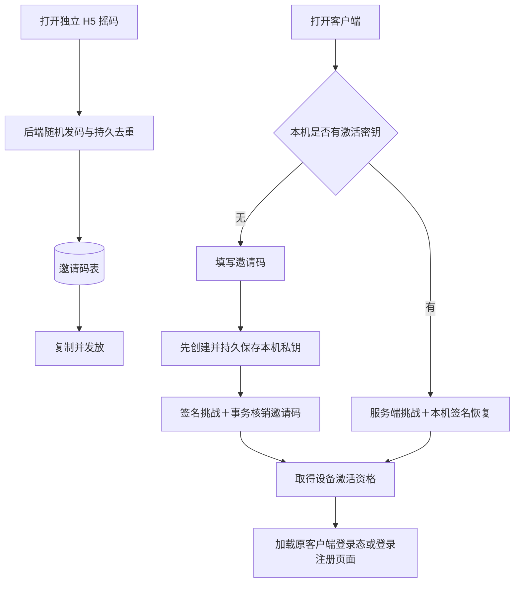

# 客户端邀请码：后端与 macOS 客户端改造方案

日期：2026-11-17 更新。状态：服务端、客户端和独立 H5 源码已实现；本地 `127.0.0.1:8080` 已更新、应用 138、139 迁移并开启设备限制。H5 固定入口为 `http://127.0.0.1:4179/`，无需登录或链接密钥，支持邀请码备注。测试、正式环境当前策略接口仍为 404，尚未部署本套邀请 API。有效 profile 已补齐，真实签名包的 Secure Enclave 激活及跨进程/路径恢复已验收，实际升级、卸载重装、锁屏/解锁与新用户验收范围见 5.3。

当前后端迁移为 `000138_desktop_access` 和 `000139_desktop_invite_notes`，产品模块为 `internal/app/desktopaccess`；桌面模块为 `src/desktop-access/` 和 `native/desktop-access.mm`。Web 未为本功能新增分支或改造普通登录。

## 1. 已确定的产品规则

- 只限制官方桌面客户端；普通 Web 的注册、登录和使用保持原样。
- 获授权的发码人员持专用链接直接打开独立 H5 摇码、复制后自行发放，无需管理员账号或 Web 登录。不是公开自助领码活动，不绑定邮箱或账号。
- 邀请码为六位字母和数字，建议延用 H5 的 32 字符表，排除 `I/O/0/1`，且至少包含一个字母和一个数字。
- 生成后状态为 `active`，可以立即使用。成功激活一次后永久变为 `used`；“回收”指失效，不是删除后重新发放。
- 新用户、旧用户、有缓存登录态的用户，都必须先通过本机激活检查，才能进入客户端业务界面。
- 同一台 Mac、同一 macOS 用户正常卸载重装，如果原钥匙串和密钥仍在，可以恢复，无需再次输入邀请码。
- 换电脑、换系统用户、重装系统或密钥已被清理，需要新码。激活资格属于设备密钥，不跟随邮箱或登录账号。
- 同一激活设备允许按现有产品规则切换账号；不增加账号白名单。账号本身被停用等既有限制继续生效。
- H5 未使用码可“作废”，已使用码可“吊销”对应设备。默认“当前”隐藏两种失效记录，切换“已作废”才显示；吊销前二次确认，不删除或恢复核销码，不清理本机钥匙串。
- 邀请码下方可添加、编辑、清空最多 200 个字符的备注，用于记录发给谁；备注不绑定邮箱或账号、不参与激活校验，所有状态均可编辑并持久保存到当前环境数据库。

## 2. 现有系统与可复用部分

以下为本次读取代码确认的现状，路径均相对于对应仓库。

| 位置 | 已有能力 | 本方案的使用方式 |
| --- | --- | --- |
| 后端 `services/api/internal/app/bootstrap/bootstrap.go` | Gin 路由；`/api/auth/login`、`register`；受保护 `/api`；客户端 WebSocket 注册入口 | 新增桌面激活路由及管理路由，不对普通 Web 登录增加邀请码字段 |
| 后端 `internal/middleware/auth.go` | `Authorization: Bearer` JWT；账号状态检查；`RequireAdmin` | 兼容管理 API 继续检查管理员；独立 H5 接口无需账号或链接鉴权 |
| 后端 `internal/idempotency/middleware.go` | 请求摘要、进程内并发合并及 180 秒响应缓存 | 可参考实现，但不能作为长期发码去重的最终保障；且当前主要挂在 `/v1` 面 |
| 后端 `internal/middleware/ratelimit.go` | Redis 限流；Redis 缺失或报错时当前实现放行 | 复用组件结构；邀请码暴力尝试路径需要严格失败策略，不能直接照搬放行行为 |
| 后端 `services/api/go.mod` | PostgreSQL、GORM、Redis 与 UUID 依赖 | 沿用现有基础设施，不需要新建服务或更换认证体系 |
| 桌面端 `src/main.cjs` | 创建主窗口，初始化本机执行、runtime、桌宠及菜单 | 插入统一激活状态机；将业务启动推迟到校验通过 |
| 桌面端 `src/bundledFrontend.cjs` | 内置 Web 资源；`/api` 等请求透传；主进程请求钩子 | 保持 Web 源码不变，在可信客户端入口拦截与适配 |
| 桌面端 `src/client-runtime.cjs` | 读取既有 `matter.token`；连接 `/api/client-runtime/ws`；注入运行时证明 | 激活后才启动，给桌面连接增加设备持钥证明；不把激活私钥交给 Web |
| 桌面端 `src/local-exec/pairing.cjs` | `safeStorage` 加密令牌后写本地配置 | 保留原有用途；不能据此认为删除 userData 后激活信息仍能恢复 |
| Web `src/components/core/{Button,Input,DataTable}.tsx` | 公共组件及 `src/design/primitives/` 样式 | H5 已提取使用到的样式和类名；移植到 React 时再直接使用组件 |

独立 H5 直接打开固定地址，不读取 `matter.token`、URL fragment 或其他访问凭证。静态 `config.js` 默认仍为演示模式；本机 `serve.cjs` 提供回环 API 代理和真实配置，不修改 Web 源码。未确认发码请求 UUID 保留在 sessionStorage，仅用于幂等；演示码不能激活客户端。

## 3. 总体分工与流程

后端负责码和设备的权威状态、鉴权、随机生成、幂等、并发核销、挑战验签、限流与吊销。客户端负责先拦截、保护和使用本机私钥、恢复激活，以及校验通过后再启动业务。H5 只负责操作界面，滚轮停止在服务端实际返回的结果上。

## 4. 后端改造

### 4.1 模块和数据表

产品层包 `services/api/internal/app/desktopaccess/` 由 bootstrap 注入数据库、Redis 和配置。通用 reverse transport 只接收回调，不依赖邀请码产品包，不复用浏览器配对码表。

新增 forward migration `000138_desktop_access`，没有修改历史迁移。两张持久表：

`000139_desktop_invite_notes` 为邀请码表新增 `note text NOT NULL DEFAULT ''`，数据库限制最多 200 个字符；旧记录自动为空，不改变原码或资格。启动 readiness 显式读取该列，未迁移的新部署不会假装就绪。

| 表 | 主要字段与约束 |
| --- | --- |
| `mt_desktop_invites` | `id`；`code_digest UNIQUE`；`code_ciphertext`；`status`；`issuer_user_id`；`issue_request_id`；`issue_request_digest`；`created_at`、`used_at`、`revoked_at`；`UNIQUE(issuer_user_id, issue_request_id)` |
| `mt_desktop_activations` | `id`；`public_key_spki`；`public_key_fingerprint UNIQUE`；`invite_id UNIQUE REFERENCES mt_desktop_invites`；`status`；`created_at`、`revoked_at` |

邀请码从 `active → used` 或 `active → revoked`，均不恢复为可用。设备资格失效后显示“已过期”，允许同一设备密钥核销一枚新的有效邀请码重新激活；此时旧已用码转为 `revoked`，保留原 `used_at` 和过期时间。未使用码作废和设备资格失效仍是两个操作。

使用独立服务端 lookup key 做 HMAC-SHA256 查询摘要；管理列表和丢响应重试所需原码用 AES-GCM 加密，并将行 ID 绑定为 AAD。独立发码 API 和兼容管理员 API 返回原码，客户端不持有服务端密钥，日志不记录完整码。首版不包含自动密钥版本轮换或 last-seen 写入；更换 lookup/encryption 存储密钥前必须迁移全部密文/摘要，包括已用和作废记录。启动 readiness 会尝试解密已有记录并核对摘要，不能直接换环境变量冒充轮换。

保留已使用、已作废记录的唯一摘要，不因清理历史而让旧码重新可用。上线需同步 `.env.example`、配置校验和运维密钥备份策略，不把密钥写入仓库或复用 JWT secret。

### 4.2 独立 H5 接入

本地固定入口为 `http://127.0.0.1:4179/`，直接打开即可使用，无需改 Web SPA。页面与独立发码 API 均不要求账号、角色、token 或链接密钥。

- `serve.cjs` 默认连接 `http://127.0.0.1:8080`，可用 `INVITE_API_ORIGIN` 指定本地 API；不需要 Web 服务或登录代理。保持回环/Host/静态白名单限制，其他 API 不代理。
- 页面不读取 URL fragment，不发送 `Authorization`、Cookie 或发码密钥请求头；已移除发码链接密钥配置。邀请码存储密钥和客户端设备证明保持不变。
- API 失败不会降级演示或生成本地假码；保留请求 UUID 重试。请求 UUID 仅用于防重复发码，不是鉴权信息。

| 接口 | 用途 | 关键条件 |
| --- | --- | --- |
| `GET /api/desktop-access/invites?status=&q=&cursor=` | 查询记录 | 无需鉴权；固定每页 20 条，游标按 `(created_at,id)` 排序；邀请码或备注任意片段包含匹配，不区分大小写 |
| `POST /api/desktop-access/invites` | 生成一码 | 无需鉴权、`Idempotency-Key` 和 `{}`；返回实际 `Invite` |
| `POST /api/desktop-access/invites/:id/note` | 保存/清空备注 | 无需鉴权；仅接受 `{"note":"文本"}`，trim 后最多 200 个 Unicode 字符，空字符串清空；只更新 note，返回完整当前记录 |
| `POST /api/desktop-access/invites/:id/revoke` | 作废未使用码 | 无需鉴权；重复作废返回原状态，已使用返回冲突 |
| `POST /api/desktop-access/invites/:id/revoke-activation` | 吊销已使用码对应的设备资格 | 无需鉴权、邀请码 ID；事务锁定邀请码及关联设备，重复吊销保持首次时间；无关联设备或未使用返回冲突 |
| `POST /api/admin/desktop-activations/:id/revoke` | 吊销设备资格 | 仍要求管理员 JWT、当前角色及账号状态，H5 不调用 |

原 `/api/admin/desktop-invites` 系列保留供兼容，仍要求管理员；H5 不再使用。列表保留每页 20 条、游标和搜索，新增 `current` 默认筛选：数据库分页前隐藏作废码/过期资格；`used` 仅有效已使用，`revoked` 合并两种失效记录，空值/`all` 保持查询全部。列表附不含公钥的设备资格元数据。设备改用新码后，旧码 `status=revoked` 并保留 `usedAt`，H5 据此继续显示“已过期”；未使用即作废的码显示“已作废”。

2026-11-17 搜索改为邀请码与备注任意连续片段匹配。为保持邀请码加密存储，后端在数据库状态筛选后按顺序分批读取、解密匹配，再对匹配记录分页；特殊字符均为文字，不参与 SQL 模式。无数据库迁移，当前灰测规模采用顺序扫描，未增加明文码列或检索服务。H5 统一采用相同匹配逻辑，输入框不再限制六位；作废/吊销复用危险色胶囊按钮，保留二次确认和原处理流程。

### 4.3 同时点击、重复发码与唯一性

页面生成一个请求 UUID，在成功确认前持续复用；连续点击合并，网络超时不生成新 UUID。服务端用同一次数据库 INSERT 同时落邀请码、请求 UUID 和正文摘要，通过 `(issuer, 请求UUID)` 唯一约束处理冲突并回查当前记录；不用进程锁或响应缓存实现持久幂等。

- 同一发码身份、同一请求编号：并发只留下一条邀请码，重试查询并返回这条记录的**当前状态**，不能重放过期的 `active` 响应。
- 独立发码使用固定 issuer `desktop-invite-console`，移除链接密钥后重试仍返回原记录，不恢复已作废/已使用码。已有管理员发码记录保留；从旧页面迁移前先核对未确认请求。
- 同一请求编号、不同参数摘要：返回 `409 invite_conflict`。
- 不同请求编号：可以各发一个码；不同发码人员互不阻塞。同码碰撞由 `code_digest` 唯一约束兜底，有限次重新随机生成，不做“先查不存在再无约束插入”。
- 进程重启、多 API 实例或缓存过期后仍由数据库去重。不要把持久记录做成只保留 180 秒的响应缓存。
- 若以后增加发码配额，配额扣减也在同一事务内完成，不能 `COUNT` 通过后再分别插入。当前不增加公开抢码或概率抽奖机制。

### 4.4 激活、恢复与挑战协议

登录前的接口不能依赖用户 JWT；它们只授予设备激活资格，不能直接登录账号。

| 接口 | 请求与结果 |
| --- | --- |
| `GET /api/desktop-access/policy` | 返回 `{required,protocol:1}`；显式关闭才兼容放行；网络错误、404 或协议不匹配不放行 |
| `POST /api/desktop-access/challenges` | 提交 `{publicKey,purpose}`，返回 challenge ID、随机 nonce、过期时间；用途为 `activate`、`restore`、`renew`、`auth`、`runtime_connect` |
| `POST /api/desktop-access/activate` | 正文 `{code}`；公钥和签名放请求头；原子核销后返回资格 `id/status/createdAt` |
| `POST /api/desktop-access/restore` | 正文 `{}` 和新挑战签名，按公钥查回资格，不需要原邀请码或本地设备 ID |
| `POST /api/desktop-access/renew` | 正文 `{}` 和新挑战签名，重查资格；不签发可复制的 Bearer 激活会话 |

采用 P-256 ECDSA/SHA-256，公钥为规范 SPKI DER，签名为 ASN.1 DER，两者用无 padding 的 base64url 传输。原生模块导出 X9.63 公钥点，由主进程显式转换为 SPKI。HTTP 请求头为 `X-Desktop-Key`、`X-Desktop-Challenge`、`X-Desktop-Signature`。

签名内容要版本化，绑定服务 origin、用途、HTTP 方法、固定路径、challenge ID、nonce 以及请求正文的 SHA-256；双方对**实际发送的 body 字节**计算摘要，签名放请求头，避免重新序列化 JSON 导致验签不一致。不能只签一个设备 ID。

签名文本由 `matter-desktop-access-v1`、origin、用途、方法、路径、challenge ID、nonce、正文 SHA-256 十六进制依次以换行连接，无末尾换行。HTTP 正文上限 64KiB。挑战使用 32 随机字节 nonce、120 秒有效，绑定公钥与用途。先验签，再以 Redis 比较删除脚本原子消费；Redis 故障返回 `503`。挑战已消费但数据库事务失败时，取得新挑战重试，不会因此消费邀请码。

核销事务应做到：

1. 完成挑战、用途、持钥证明及请求格式验证。
2. 用 PostgreSQL 事务 advisory lock 串行化同一公钥；已有有效激活则恢复，不再扣另一个码；过期资格必须输入新的未使用邀请码，旧码不能恢复。
3. 锁定新邀请码并确认仍为 `active`。首次激活插入设备资格；重新激活按旧码→设备的顺序加锁，将旧码设为 `revoked` 并保留核销/过期时间，再把原设备资格关联新码、恢复 active、清空当前过期时间。新码核销、旧码归档和设备更新在同一事务提交，失败全部回滚。
4. 用公钥唯一约束和 `invite_id UNIQUE` 处理并发；竞争失败后回查同公钥结果或返回邀请码不可用。

必须满足：同码被两台设备同时提交，只成功一台；同一设备因连点、重试或响应丢失，不产生两个设备资格。作废和核销争用同一条码记录，只有一个状态迁移成功。

响应丢失后，客户端用已保存的私钥走 `restore` 即可找回；即使本地设备 ID 尚未保存，也可按公钥找回。所以设备 ID 是索引，不是可复制后直接使用的密码。

### 4.5 试码限制、持钥检查和吊销

- 核销按直接来源 IP 每分钟 10 次、全局每分钟 600 次；挑战/恢复/桌面认证按 IP 每分钟 600 次、全局 10,000 次。Redis 原子计数；过限 `429`、`Retry-After:60`，故障 `503`。当前使用 `RemoteIP()`，忽略可伪造的转发头；反向代理部署会合并来源，需在可信边缘配置独立用户限流，并按公司 NAT/灰测人数验收阈值。
- 无效、已使用、作废码，对未授权调用统一返回“邀请码不可用”，不公开领码列表或不同状态的查询 oracle。
- 六位码不适合无边界公开尝试。生成数量、尝试失败率、异常来源须可观测，日志对码和 token 脱敏。
- 首版省去激活 lease：恢复、定期检查、桌面认证各自使用新的单次挑战。runtime 新连接的证明绑定 runtime ID 和账号 JWT 的 SHA-256，挑战重放不能建立第二条连接；重连前先取得新证明，避免占用服务端首帧认证的 5 秒期限。
- 客户端每 20 秒复查。本次进程在线确认后，断网、超时或服务暂不可用时保留主窗口和本次激活状态，顶栏提示激活服务暂不可用，后台继续检查。冷启动须在线校验，连接不可用时显示原生重试和退出。失去激活资格时停止桌面业务并要求邀请码，密钥或协议错误显示验证失败。服务端在 runtime 心跳（20 秒）和工具上下文解析时重查资格，吊销后关闭连接。以上是检查周期，数据库或网络异常下不能当成已验收的严格 30 秒 SLA。
- Redis 中仅保存短期挑战和限流预算；数据库是码和资格状态的最终事实源。重启 Redis 不会把已用码变回可用。

## 5. 客户端改造

### 5.1 激活状态机与入口

`src/desktop-access/` 包含 `controller.cjs`、`service.cjs`、`keys.cjs` 和 `gate.cjs`；输入由 `native/desktop-access.mm` 中的 AppKit `NSAlert` / `NSTextField` 提供，无 HTML 激活页或相关 renderer IPC。状态为：

`checking → unactivated / active / retryable_error / revoked / unsupported`

- `checking`：执行本机激活检查，不加载 Matter Web，不创建可用的本机能力连接；已有原生输入弹窗保留输入、焦点及编辑能力，仅暂时禁用确定。
- `unactivated`：显示真正的 macOS AppKit 原生输入弹窗，只有一个输入框与“确定 / 退出”按钮。标题为“输入邀请码以激活应用”，描述为“激活码为一次性产物，核销后作废！”，输入框下说明为“没有邀请码？联系管理员提供。”；系统负责深浅色、焦点和按钮外观，合法六位码才可确定。失败保留本次内存输入并显示真实错误；退出不核销。
- `active`：统一调用一次业务启动方法，再显示已有登录态或原注册/登录页。
- `retryable_error`：网络、服务不可用、钥匙串暂时锁定等只提示重试，不显示为“未激活”，不要求再消耗一个码。
- `revoked`：停止桌面接入，统一提示“本机激活资格已过期，请输入新的邀请码。”；输入框可聚焦编辑，合法新码可提交。保留本机钥匙串和账号数据，不自动发码或绕过核验。
- `unsupported`：硬件或签名条件不满足时明确说明，不静默降级为可导出的软件私钥。

原生弹窗首次打开/用户重新唤起时，将可用输入框设为 first responder；从不可编辑恢复时重新聚焦。周期检查保留原编辑器及输入，仅暂时禁用确定，不在每次检查后重置焦点。已运行安装包不热加载此原生模块，需重新构建并替换客户端后生效。

`main.cjs` 的初次启动、Dock activate、窗口重建、菜单、深链、桌宠唤起和隐藏重开都调用同一状态机。旧 JWT 只决定激活后的账号登录状态，不能跳过设备检查。

将 runtime、本机执行入口和桌宠业务初始化推迟到 `active`，并在失效/吊销时暂停新调用、结束受控连接和按既有取消协议收尾。保护已产生的用户文件；不删除 userData、登录态或钥匙串来“修复”激活问题。退出按钮在 gate 阶段可用；按最新界面要求，弹窗不额外放更新或重试按钮，策略仍定时重检。

### 5.2 密钥与钥匙串

已实现主进程加载的 N-API 原生模块 `native/desktop-access.mm`，仅依赖系统 Foundation/Security/AppKit.framework。封装查找/创建密钥、导出公钥、对带固定协议前缀的数据签名；没有面向远程 Web 的通用签名 IPC。开发态或无嵌入 profile 的应用拒绝创建激活密钥，不回退软件私钥。

1. 在 Secure Enclave 中创建永久密钥，使用稳定的 application tag；按正式/测试环境及服务 origin 隔离，不包含应用版本号。
2. 使用数据保护钥匙串、`AfterFirstUnlockThisDeviceOnly` 和 `PrivateKeyUsage`；不要求每次签名使用 Touch ID。实际锁屏/解锁行为仍需签名包验收。
3. **先确认密钥能持久查回并成功签名，再向后端核销邀请码。** 不把私钥明文导出，也不把原邀请码作为长期凭证。
4. 首版不持久保存设备 ID 或邀请码；服务端按公钥直接恢复。私钥丢失时不能仅凭 ID 恢复。
5. 正常卸载应用不主动清理激活项；重新安装以相同身份查回密钥并完成服务端新挑战。

普通应用写自己可访问的钥匙串项不需要先让用户点一个自制“允许保存”弹窗。但不能保证系统永远不提示：锁定状态、访问控制、签名身份变化等应保留系统真实结果。可在保存成功后给一次简短提示“已在本机安全保存，正常重装可恢复”，不承诺系统重装、钥匙串清理或换电脑仍然恢复。

不默认设置每次签名都必须 Touch ID/用户在场，否则会影响自动启动和续期；如未来需要高敏操作再单独设计。

### 5.3 Apple 配置和发布先决条件

无需 Apple 为每个邀请码或每次激活审批，也不需要 Apple 托管这套后端。**但 Developer ID 签名和公证并不自动等于能使用数据保护钥匙串。**

Apple TN3137 明确：数据保护钥匙串的访问组 entitlement 需要 provisioning profile 授权；Secure Enclave 保护密钥使用该实现。库代码继承宿主主可执行文件的 entitlement。因此先在真实签名的主应用里验证：

- 团队账号、App ID、授权的应用标识/Keychain Access Groups 与 profile 是否齐备，正式和测试应用是否正确分组。
- 主应用嵌入正确 profile；仅添加 plist 字段或仅重新公证不足以证明可用。
- 原生 `.node` 模块按当前 Electron/架构构建，移出 ASAR 并按同一团队签名，纳入现有签名、公证及包内一致性检查。
- 在真实支持设备上验证创建、退出后查回、升级后查回、正常卸载重装查回、锁屏/解锁和新用户环境。当前发布目标为 arm64，也不能把模拟测试当成实际 Secure Enclave 验收。

2026-11-16 用户后续提供的 `matter.provisionprofile` 已确认授权实际应用 ID，并与本机 Developer ID 证书匹配。新签名测试包已通过真实 Secure Enclave 永久密钥、私钥导出拒绝、核销/恢复、跨进程和 DMG/ZIP 不同 bundle 路径恢复、错误私钥/重放拒绝及设备吊销验证。QA 使用独立标签，已吊销测试设备并删除测试硬件密钥，没有消耗用户正常设备激活。用户补充实际 Issuer ID 后，通过本机已有 API 密钥直接认证完成应用和 DMG 公证，均为 Accepted，最终归档票据、签名和系统分发检查通过。**正常卸载重装、升级、锁屏/解锁和新用户环境仍未验收**；不以路径恢复替代这些验收，生产强制未开启。若团队 profile 或目标硬件不支持，不默认降级软件密钥。

打包使用 `MINDUCK_DESKTOP_ACCESS_PROFILE=/absolute/path/to/macOS.provisionprofile`；正式启用前同时设置 `MINDUCK_DESKTOP_ACCESS_REQUIRED=1`，缺失 profile 会终止打包。脚本检查平台、有效期、App ID 与访问组，再生成含字面 entitlement 键的主应用 plist；原生模块置于 Resources/native，并在 afterPack 核对编译输出。未提供 profile 的普通兼容包只能配合后端 `required:false`，不能用于强制激活发布。

### 5.4 与原 Web 登录及 runtime 的连接

普通 Web 继续使用原 `/api/auth/*`。如需服务端也校验“官方客户端这次登录已激活”，新增 `/api/desktop/auth/login`、`register` 等受激活证明保护的薄路由，复用原 AuthService；不要复制密码校验、注册事务或邮件验证逻辑。

客户端主进程在可信 bundled 前端请求入口，将明确列出的登录/注册请求映射到桌面路由并附加持钥证明。保持原响应格式；Web 源码无需新增邀请分支。映射要保留方法、body、账号认证和既有安全检查，不全局改写普通业务 API。

`/api/client-runtime/ws` 还要在账号 JWT 验证之外加入激活设备及本连接持钥证明，证明从主进程发送，不进入网页 localStorage。现在的运行时 proof 是登录后的执行上下文，不能当作登录前激活资格复用。新增字段需要服务端与 `src/local-exec/connection.cjs` 一起做协议兼容。

已有登录态的用户先过 gate，之后可延续原登录，不强迫再输密码。账号退出只结束账号连接，保留本机设备激活资格；账号切换时重新绑定连接所属账号，不能沿用上一账号的运行时上下文。

## 6. 安全边界必须说清楚

- 复制设备 ID、激活记录或钥匙串里的包装数据到另一台 Mac，不足以通过新挑战；还需要原不可导出的私钥。
- 本方案是持钥证明，**没有实现远程硬件/应用完整性 attestation**。服务端收到一个公钥，不代表它已经证明公钥一定来自未被修改应用中的 Secure Enclave。
- Web 正常开放且共用业务 API 时，攻击者可以改客户端或自行调用 Web API。不能用 UA、`X-Client`、隐藏页面、`Origin` 或普通版本号声称彻底阻止这种行为。
- 可明确保证的目标是：官方客户端所有入口先激活；服务端发码/核销不可重复；恢复必须持有设备密钥；桌面专属登录入口与 runtime 连接在服务端验资格。若要对抗定制客户端，还需另定可验证的应用完整性和端点授权策略，会明显扩大范围。
- 激活会话若被设计成纯 Bearer，复制后在有效期内仍可能被使用；因此桌面连接不能只验证 lease 字符串，要验证本连接的持钥证明。不能把“私钥不可导出”扩大解释成所有令牌不可盗用。

## 7. 实施顺序与验收

| 阶段 | 交付 | 完成条件 |
| --- | --- | --- |
| 1. 原生可行性 | 数据保护钥匙串/Enclave 最小验证，真实签名 profile 和稳定标识 | 真机持久化、签名、升级/重装恢复通过；不核销生产邀请码 |
| 2. 后端 | 两张表、新迁移、独立发码 API、挑战/激活/恢复/吊销 | 专用 PostgreSQL 测试库完成并发与提交边界测试 |
| 3. H5 接口 | 固定地址直达、无鉴权发码、游标列表、真实结果驱动滚轮 | 生产模式失败不生成本地假码，手机可完成发码与复制 |
| 4. 客户端 | gate、原生密钥模块、恢复、runtime/桌面登录保护 | 所有官方入口不可跳过；有旧 JWT 也先检查；失败可恢复 |
| 5. 灰测上线 | 后端先部署兼容接口，新客户端发布后切强制策略 | 旧版本明确提示升级；Web 回归不受影响；吊销生效 |

先部署迁移和兼容 API，`MATTER_DESKTOP_ACCESS=off`，确认 policy 返回 `required:false`，再发布新客户端；旧后端没有 policy 时新客户端会拦截。签名包验收、更新入口和 H5 页面就绪后，才设置 `MATTER_DESKTOP_ACCESS=on`，同时配置两个独立 32 字节标准 base64 密钥 `MATTER_DESKTOP_INVITE_LOOKUP_KEY`、`MATTER_DESKTOP_INVITE_ENCRYPTION_KEY`。签名 origin 默认复用当前环境的 `PUBLIC_API_BASE_URL`，自动去除末尾 `/`；`MATTER_DESKTOP_ACCESS_ORIGIN` 留空即可，仅需独立覆盖时填写精确 origin。最终地址必须与客户端实际访问的 API origin 一致，不含路径、查询或 fragment，非法配置会阻止启动。H5 发码配置 `MATTER_DESKTOP_INVITE_ADMIN_PASSWORD` 作为独立共享密码。该开关也控制真实发码，提前联调用隔离环境。生产 origin 使用 HTTPS。回滚可关闭限制，但不得删除已用码或设备密钥。

### 三环境隔离和已核实范围（2026-11-17）

- 三个代码仓或三个 URL 不等于三个独立数据库。每个环境必须实际配置独立数据库、Redis、存储密钥与精确 origin，并先应用 138、139 迁移；不要向另一环境复制激活表/邀请码表充当部署。
- 本地已核实为本机 Docker PostgreSQL `127.0.0.1:5433/weave_db`，数据卷为 `minduck-matter-local_postgres_data`，Redis 为 `127.0.0.1:6380`。本机 LAN 地址与测试服务器不同；尚无测试/正式运行配置，未确认两者的数据库和数据卷。
- 测试 `http://192.168.11.70:8080`、正式 `https://matter.minduck.com` 的 `/health` 均 200、`/api/desktop-access/policy` 均 404；它们尚不能只切地址就使用本套邀请码流程，本轮没有远端部署。
- 客户端钥匙串 tag 为固定前缀加 origin 的 SHA-256；切换服务地址并重启后，向目标后端检查其自己的激活资格，签名同样绑定 origin。已在正式激活不等于测试已激活；回到原已激活环境可恢复。开关 off 是显式关闭限制，不是跨环境恢复。
- 专用 PostgreSQL 独立 schema 回归验证外来码和资格不能恢复、吊销互不影响，客户端回归验证三 origin 密钥标签/签名不同、回到同 origin 标签稳定。这验证了隔离机制，不代替远端数据库审计；六位文本若偶然相同，也只是各环境自己的独立记录。
- H5 备注通过当前环境 API 保存；原子 UPDATE 仅改 note，和作废/核销并发不会恢复原码状态。手机布局沿用四列表格，备注 dialog 复用既有输入框和按钮样式，无新增依赖。

必要验收用例：

- 100 个同请求编号并发发码仅一条；不同请求编号各自唯一；API 重启/多实例后重试一致；相同 key 不同 body 冲突。
- 同码两把公钥并发激活仅一次成功；同公钥跨两个码的并发最多消费一个码；作废与核销竞争只成功一个。
- 模拟核销已提交但响应丢失，用原公钥恢复成功；首次密钥保存失败时不消耗码。
- 挑战过期、重放、换用途、换 origin、换 body、换私钥都失败；Redis 故障不放行试码。
- 卸载重装、升级、重启、锁屏恢复、服务地址切换、钥匙串缺失、设备吊销及账号切换均有明确结果。
- 有历史登录态仍不能绕过 gate；深链/菜单/桌宠不提前加载业务；设备失效不取消普通 Web 的账号资格。
- H5 重点验收 375/390/430px，再验收 768/1024/1440px；真实 iPhone Safari 的触摸、键盘和剪贴板另做实机验收。

已验证：专用 PostgreSQL 上 100 路幂等发码、同码/同设备竞争、作废竞争、失败回滚与恢复；独立真实 Redis 原子消费/限流和故障关闭；HTTP 旧账号保护、JWT 管理员降权、重放/正文篡改；runtime 传输吊销；Electron gate 生命周期、IPC 来源拒绝、真实 Chromium 请求的精确正文签名透传。H5 六种宽度深浅主题及分页交互通过。有效 profile 补齐后的实际 Developer ID 签名包通过本机真实 Secure Enclave 激活与跨进程/路径恢复，见 5.3 和[分发记录](macos-distribution.md)。以上不包含实际卸载重装、升级、锁屏/解锁、新用户、公开部署或真实手机验收。

## 8. 官方资料

- Apple：[TN3137 — On Mac keychain APIs and implementations](https://developer.apple.com/documentation/technotes/tn3137-on-mac-keychains)。核对数据保护钥匙串、profile 授权、宿主 entitlement 与 Secure Enclave 的关系。
- Apple：[Protecting keys with the Secure Enclave](https://developer.apple.com/documentation/security/protecting-keys-with-the-secure-enclave)。核对不可导出密钥、硬件支持和签名 API；本方案协议选用 P-256。

资料用于核对 Apple 配置前提。代码通过不代表已部署；profile 已补齐和已验收范围见 5.3，真机升级/重装/锁屏恢复和真实 iPhone Safari 仍待验收。

### 原生激活弹窗（2026-11-16）

- AppKit `NSAlert` 保持原生外观，窗口直接使用 Electron 已有的应用事件循环；不再启动阻挡 macOS 菜单与 `⌘Q` 的 AppKit modal session。原生模块同时负责输入与原有持钥操作，但输入本身不要求 profile。macOS profile 仍是 Secure Enclave 持久化激活的前置条件。
- 移除原 HTML、CSS、页面脚本、preload 与激活 renderer IPC；复用既有 controller/service 的策略检查、单次提交与核销规则。应用退出/激活成功时关闭原生窗口，内存中的原始码随之清除。
- 退出先终止 controller，阻止仍在等待的策略响应启动业务。原生关闭操作先取走已收到的按钮动作，已点击“退出”即使碰上策略成功关闭弹窗也不能被当作普通 dismissed 丢掉。
- `prestart` 和 `pnpm test:desktop-access` 先编译原生模块。单测覆盖输入归一、退出、重复窗口、重试保留输入、状态禁用、激活/退出清理；Electron smoke 验证无 HTML 窗口、弹窗期间事件循环继续运行，并支持 `MATTER_NATIVE_PROMPT_INTERACTIVE=1 pnpm test:desktop-access` 做隔离原生点击验收。

- 2026-11-16 退出修复：先复现旧模态会话吞掉 `⌘Q`，及原生退出动作在轮询前被策略关闭清除的单测失败，再修复。261 项桌面测试、原生 smoke 和实际 Electron 进程的 `⌘Q`／慢策略等待期间点击退出通过；记录 `/tmp/matter-quit-debug-20261116/`。本轮仅更新源码，现有安装版与已交付 DMG/ZIP 未替换，不能把新回归结果归到旧包上。

- 已交付测试产物位于 `release/invite-native-test-20261116/`：0.1.10 arm64 应用与 DMG 均公证 Accepted，259 项桌面测试及最终 DMG 内 25 项回归通过。原生交互检查使用隔离服务夹具，不能表述为真实核销。交付时 policy 仍 404、无适用 macOS profile，完整链路待部署和签名配置后验收，详见 macOS 分发记录。
