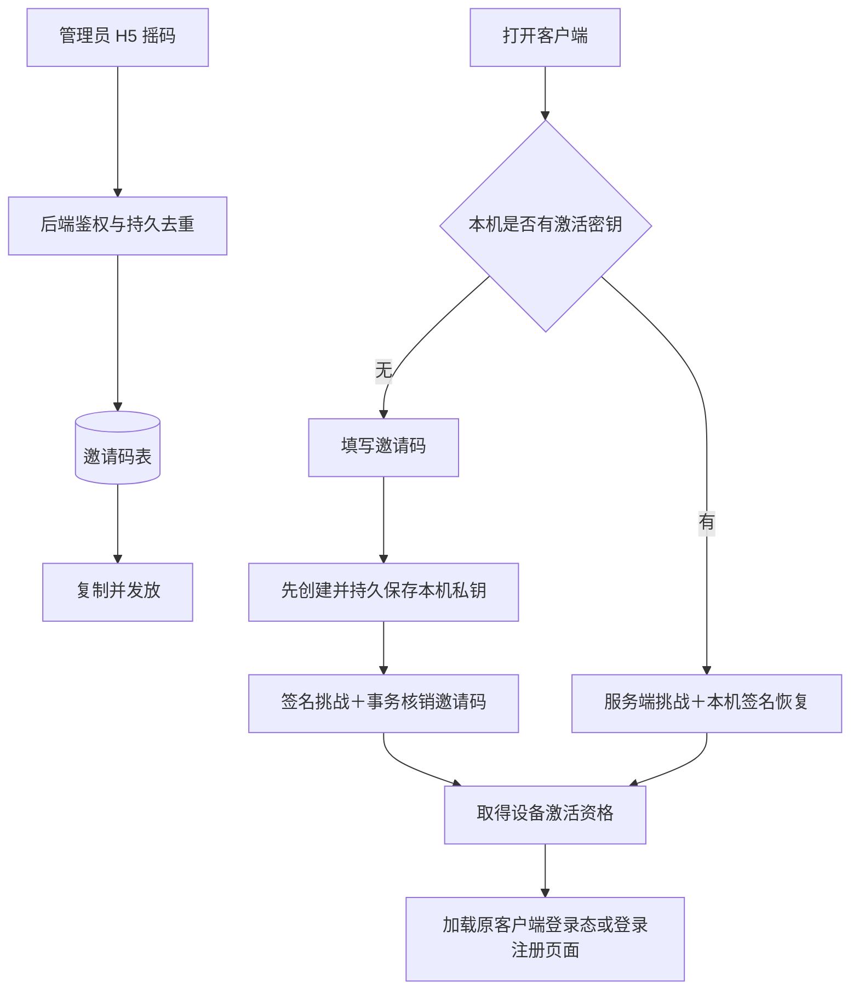

# 客户端邀请码：后端与 macOS 客户端改造方案

日期：2026-11-16。状态：待实施方案；本次只修改独立 H5，不包含下面的服务端、客户端或签名改造。

## 1. 已确定的产品规则

- 只限制官方桌面客户端；普通 Web 的注册、登录和使用保持原样。
- 管理员通过独立 H5 摇码、复制后自行发放。不是公开自助领码活动，不绑定邮箱或账号。
- 邀请码为六位字母和数字，建议延用 H5 的 32 字符表，排除 `I/O/0/1`，且至少包含一个字母和一个数字。
- 生成后状态为 `active`，可以立即使用。成功激活一次后永久变为 `used`；“回收”指失效，不是删除后重新发放。
- 新用户、旧用户、有缓存登录态的用户，都必须先通过本机激活检查，才能进入客户端业务界面。
- 同一台 Mac、同一 macOS 用户正常卸载重装，如果原钥匙串和密钥仍在，可以恢复，无需再次输入邀请码。
- 换电脑、换系统用户、重装系统或密钥已被清理，需要新码。激活资格属于设备密钥，不跟随邮箱或登录账号。
- 同一激活设备允许按现有产品规则切换账号；不增加账号白名单。账号本身被停用等既有限制继续生效。

## 2. 现有系统与可复用部分

以下为本次读取代码确认的现状，路径均相对于对应仓库。

| 位置 | 已有能力 | 本方案的使用方式 |
| --- | --- | --- |
| 后端 `services/api/internal/app/bootstrap/bootstrap.go` | Gin 路由；`/api/auth/login`、`register`；受保护 `/api`；客户端 WebSocket 注册入口 | 新增桌面激活路由及管理路由，不对普通 Web 登录增加邀请码字段 |
| 后端 `internal/middleware/auth.go` | `Authorization: Bearer` JWT；账号状态检查；`RequireAdmin` | 复用管理员身份验证；发码时再核对当前管理员资格 |
| 后端 `internal/idempotency/middleware.go` | 请求摘要、进程内并发合并及 180 秒响应缓存 | 可参考实现，但不能作为长期发码去重的最终保障；且当前主要挂在 `/v1` 面 |
| 后端 `internal/middleware/ratelimit.go` | Redis 限流；Redis 缺失或报错时当前实现放行 | 复用组件结构；邀请码暴力尝试路径需要严格失败策略，不能直接照搬放行行为 |
| 后端 `services/api/go.mod` | PostgreSQL、GORM、Redis 与 UUID 依赖 | 沿用现有基础设施，不需要新建服务或更换认证体系 |
| 桌面端 `src/main.cjs` | 创建主窗口，初始化本机执行、runtime、桌宠及菜单 | 插入统一激活状态机；将业务启动推迟到校验通过 |
| 桌面端 `src/bundledFrontend.cjs` | 内置 Web 资源；`/api` 等请求透传；主进程请求钩子 | 保持 Web 源码不变，在可信客户端入口拦截与适配 |
| 桌面端 `src/client-runtime.cjs` | 读取既有 `matter.token`；连接 `/api/client-runtime/ws`；注入运行时证明 | 激活后才启动，给桌面连接增加设备持钥证明；不把激活私钥交给 Web |
| 桌面端 `src/local-exec/pairing.cjs` | `safeStorage` 加密令牌后写本地配置 | 保留原有用途；不能据此认为删除 userData 后激活信息仍能恢复 |
| Web `src/components/core/{Button,Input,DataTable}.tsx` | 公共组件及 `src/design/primitives/` 样式 | H5 已提取使用到的样式和类名；移植到 React 时再直接使用组件 |

独立 H5 当前的 API 适配器是“同源 Cookie＋CSRF”的占位契约。**现有后端实际使用 Bearer JWT**，接后端时必须按下面的 JWT 方式调整，不能只把页面切到 `api` 就认为已经接通。

## 3. 总体分工与流程

后端负责码和设备的权威状态、鉴权、随机生成、幂等、并发核销、挑战验签、限流与吊销。客户端负责先拦截、保护和使用本机私钥、恢复激活，以及校验通过后再启动业务。H5 只负责操作界面，滚轮停止在服务端实际返回的结果上。

## 4. 后端改造

### 4.1 模块和数据表

建议新增产品层包 `services/api/internal/app/desktopaccess/`，由 bootstrap 注入数据库、Redis、配置和时钟。不放进通用 agent runtime，不复用“浏览器配对码”表代替邀请资格。

使用新的 forward migration，编号实施时按当时最大编号分配，不回改历史迁移。首版两张持久表即可：

| 表 | 主要字段与约束 |
| --- | --- |
| `mt_desktop_invites` | `id`；`code_digest UNIQUE`；`code_ciphertext`、`encryption_key_version`；`status`；`issuer_user_id`；`issue_request_id`；`issue_request_digest`；`created_at`、`used_at`、`revoked_at`；`UNIQUE(issuer_user_id, issue_request_id)` |
| `mt_desktop_activations` | `id`；`public_key_spki`；`public_key_fingerprint UNIQUE`；`invite_id UNIQUE REFERENCES mt_desktop_invites`；`status`；`created_at`、`last_seen_at`、`revoked_at` |

邀请码状态仅允许 `active → used` 或 `active → revoked`。设备资格仅允许 `active → revoked`；作废未使用邀请码和吊销已激活设备是两个操作，不能混用。

不要只对六位码做普通 SHA-256 后存库：搜索空间较小。建议使用独立服务端 lookup key 做 HMAC 查询摘要；由于管理表格和丢响应重试仍需显示原码，再用服务端加密保存码值。管理员 API 才能解密，客户端不持有这些服务端密钥，日志不记录完整码。加密密钥可以带版本轮换；lookup key 轮换须迁移全部摘要，包括已用/作废墓碑，保持跨版本不重复发码。

保留已使用、已作废记录的唯一摘要，不因清理历史而让旧码重新可用。上线需同步 `.env.example`、配置校验和运维密钥备份策略，不把密钥写入仓库或复用 JWT secret。

### 4.2 管理员 H5 接入

独立静态目录建议部署在现有 Web 的同源子路径，例如 `/internal/invites/`，无需改 Web SPA 源码。管理员先在原 Web 登录，再进入摇码页。

- H5 通过可替换的 `getAccessToken()` 读取当前同源既有登录态，发送 `Authorization: Bearer …`；不把 token 放在 URL、配置文件或额外持久存储里。
- 后端每个管理接口都执行 JWT、账号可用性和管理员权限检查。隐藏入口、CORS、页面来源和前端角色判断不能代替权限验证。
- `401` 提示先登录；`403` 禁止发码；不自动转入演示发码。若独立域部署，则另做明确认证交接，不能直接读取其他域的 localStorage。
- 首版不需要再建设一套管理员账号、共享密码或内置长期密钥。

管理接口建议如下，前端 `Invite` 字段继续兼容当前 `id/code/status/createdAt`：

| 接口 | 用途 | 关键条件 |
| --- | --- | --- |
| `GET /api/admin/desktop-invites?status=&q=&cursor=&limit=20` | 查询记录 | 只返回管理员授权范围；游标按 `(created_at,id)` 排序 |
| `POST /api/admin/desktop-invites` | 生成一码 | 必填 `Idempotency-Key`；当前 body 为 `{}`；返回实际 `Invite` |
| `POST /api/admin/desktop-invites/:id/revoke` | 作废未使用码 | 重复作废返回同一状态；已使用返回冲突 |
| `POST /api/admin/desktop-activations/:id/revoke` | 吊销设备资格 | 独立权限和审计；不将原邀请码改回可用 |

移动端首屏建议每页 20 条，继续加载下一页；接入时同步将 H5 当前的全量本地筛选改为服务端筛选和游标加载，不能把首批结果误当成全部记录。本次精简页仍使用本地演示记录。

### 4.3 同时点击、重复发码与唯一性

页面生成一个请求 UUID，在成功确认前持续复用；连续点击合并，网络超时不生成新 UUID。服务端把 `(管理员ID, 请求UUID)` 的唯一约束和新码写入放在同一数据库事务中。

- 同一管理员、同一请求编号：并发只留下一条邀请码，重试查询并返回这条记录的**当前状态**，不能重放过期的 `active` 响应。
- 同一请求编号、不同参数摘要：返回 `409 idempotency_key_reused`。
- 不同请求编号：可以各发一个码；多管理员互不阻塞。同码碰撞由 `code_digest` 唯一约束兜底，有限次重新随机生成，不做“先查不存在再无约束插入”。
- 进程重启、多 API 实例或缓存过期后仍由数据库去重。不要把持久记录做成只保留 180 秒的响应缓存。
- 若以后增加发码配额，配额扣减也在同一事务内完成，不能 `COUNT` 通过后再分别插入。当前不增加公开抢码或概率抽奖机制。

### 4.4 激活、恢复与挑战协议

登录前的接口不能依赖用户 JWT；它们只授予设备激活资格，不能直接登录账号。

| 接口 | 请求与结果 |
| --- | --- |
| `POST /api/desktop-access/challenges` | 提交公钥、用途，返回 challenge ID、随机 nonce、过期时间；用途包括 `activate`、`restore`、`renew`、`runtime_connect` |
| `POST /api/desktop-access/activate` | 提交邀请码、公钥及挑战签名；事务核销后返回设备 ID 与短期激活会话 |
| `POST /api/desktop-access/restore` | 提交已有公钥/设备 ID 和新挑战签名；查询激活状态并建立新会话，不需要原邀请码 |
| `POST /api/desktop-access/renew` | 用新挑战证明仍持有私钥，续期激活会话；被吊销则拒绝 |

采用 P-256 ECDSA/SHA-256，公钥统一为 SPKI，签名统一为 ASN.1 DER；原生端生成的公钥表示若不同，必须显式转换并互测。

签名内容要版本化，绑定服务 origin、用途、HTTP 方法、固定路径、challenge ID、nonce 以及请求正文的 SHA-256；双方对**实际发送的 body 字节**计算摘要，签名放请求头，避免重新序列化 JSON 导致验签不一致。不能只签一个设备 ID。

挑战使用安全随机 nonce，建议 120 秒有效，绑定公钥与用途。Redis 原子操作保证单次消费；先验签再原子核销挑战。Redis 不可用返回 `503`，不绕过验证。挑战已经消费但数据库事务失败时，客户端取得新挑战重试，不会因此消费邀请码。

核销事务应做到：

1. 完成挑战、用途、持钥证明及请求格式验证。
2. 查询同公钥已有的设备资格：已经激活就恢复该资格，不再扣另一个码；已吊销的公钥不能借新码自动洗白。
3. 锁定邀请码记录，确认仍为 `active`，插入设备资格并更新为 `used`，一并提交。
4. 用公钥唯一约束和 `invite_id UNIQUE` 处理并发；竞争失败后回查同公钥结果或返回邀请码不可用。

必须满足：同码被两台设备同时提交，只成功一台；同一设备因连点、重试或响应丢失，不产生两个设备资格。作废和核销争用同一条码记录，只有一个状态迁移成功。

响应丢失后，客户端用已保存的私钥走 `restore` 即可找回；即使本地设备 ID 尚未保存，也可按公钥找回。所以设备 ID 是索引，不是可复制后直接使用的密码。

### 4.5 试码限制、会话和吊销

- 验证码路径按可信来源 IP、公钥和全局预算组合限流，公钥可以随意生成，不能只限制公钥。具体阈值按灰测人数和公司 NAT 场景配置；过限返回 `429` 和 `Retry-After`。
- 无效、已使用、作废码，对未授权调用统一返回“邀请码不可用”，不公开领码列表或不同状态的查询 oracle。
- 六位码不适合无边界公开尝试。生成数量、尝试失败率、异常来源须可观测，日志对码和 token 脱敏。
- 建议激活会话 5 分钟有效，续期需要持钥证明；常驻连接绑定本次服务端连接挑战，不能拿一段可复制的 Bearer lease 直接建立另一台设备的连接。
- 管理员吊销设备后，服务端拒绝后续续期并关闭已绑定 runtime；建议吊销传播上限 30 秒。该数字是待实现的验收目标，不是现有能力。
- Redis 中仅保存短期挑战/会话；数据库是码和资格状态的最终事实源。重启 Redis 不得把已用码变回可用。

## 5. 客户端改造

### 5.1 激活状态机与入口

建议新增 `src/desktop-access/`，包含 `controller.cjs`、`service.cjs`、`gate.html`、`gate-preload.cjs`、`gate.js` 和样式。状态为：

`checking → unactivated / active / retryable_error / revoked / unsupported`

- `checking`：只展示本地检查界面，不加载 Matter Web，不创建可用的本机能力连接。
- `unactivated`：显示一个简单的邀请码输入弹窗，只有输入框、确定、退出及必要错误提示。Electron 的 message box 没有通用输入框，使用现有设置弹窗模式的本地受控窗口；如要真正系统原生输入，另用 AppKit 封装。
- `active`：统一调用一次业务启动方法，再显示已有登录态或原注册/登录页。
- `retryable_error`：网络、服务不可用、钥匙串暂时锁定等只提示重试，不显示为“未激活”，不要求再消耗一个码。
- `revoked`：停止桌面接入，提示联系管理员；不自动申请新码或清除账号数据。
- `unsupported`：硬件或签名条件不满足时明确说明，不静默降级为可导出的软件私钥。

`main.cjs` 的初次启动、Dock activate、窗口重建、菜单、深链、桌宠唤起和隐藏重开都调用同一状态机。旧 JWT 只决定激活后的账号登录状态，不能跳过设备检查。

将 runtime、本机执行入口和桌宠业务初始化推迟到 `active`，并在失效/吊销时暂停新调用、结束受控连接和按既有取消协议收尾。保护已产生的用户文件；不删除 userData、登录态或钥匙串来“修复”激活问题。更新检查及退出入口在 gate 阶段仍可用。

### 5.2 密钥与钥匙串

建议使用在 Electron 主进程加载的薄原生模块，调用 macOS Security.framework。原生模块只封装创建/查找密钥、导出公钥、对主进程构造的受限协议数据签名；不增加面向远程 Web 的通用签名 IPC。

1. 在 Secure Enclave 中创建永久密钥，使用稳定的 application tag；按正式/测试环境及服务 origin 隔离，不包含应用版本号。
2. 使用 `SecItem` 数据保护钥匙串保存可恢复的密钥引用，选择仅本机可用的可访问性；是否要求解锁由实际支持的属性和产品后台运行需求验证确定。
3. **先确认密钥能持久查回并成功签名，再向后端核销邀请码。** 不把私钥明文导出，也不把原邀请码作为长期凭证。
4. 激活后可在钥匙串附带保存设备 ID。ID 丢失时用公钥恢复；私钥丢失时不能仅凭 ID 恢复。
5. 正常卸载应用不主动清理激活项；重新安装以相同身份查回密钥并完成服务端新挑战。

普通应用写自己可访问的钥匙串项不需要先让用户点一个自制“允许保存”弹窗。但不能保证系统永远不提示：锁定状态、访问控制、签名身份变化等应保留系统真实结果。可在保存成功后给一次简短提示“已在本机安全保存，正常重装可恢复”，不承诺系统重装、钥匙串清理或换电脑仍然恢复。

不默认设置每次签名都必须 Touch ID/用户在场，否则会影响自动启动和续期；如未来需要高敏操作再单独设计。

### 5.3 Apple 配置和发布先决条件

无需 Apple 为每个邀请码或每次激活审批，也不需要 Apple 托管这套后端。**但 Developer ID 签名和公证并不自动等于能使用数据保护钥匙串。**

Apple TN3137 明确：数据保护钥匙串的访问组 entitlement 需要 provisioning profile 授权；Secure Enclave 保护密钥使用该实现。库代码继承宿主主可执行文件的 entitlement。因此先在真实签名的主应用里验证：

- 团队账号、App ID、授权的应用标识/Keychain Access Groups 与 profile 是否齐备，正式和测试应用是否正确分组。
- 主应用嵌入正确 profile；仅添加 plist 字段或仅重新公证不足以证明可用。
- 原生 `.node` 模块按当前 Electron/架构构建，移出 ASAR 并按同一团队签名，纳入现有签名、公证及包内一致性检查。
- 在真实支持设备上验证创建、退出后查回、升级后查回、正常卸载重装查回、锁屏/解锁和新用户环境。当前发布目标为 arm64，也不能把模拟测试当成实际 Secure Enclave 验收。

先做这一步技术验证，再接核销流程；未通过前不启用生产强制邀请。若团队 profile 或目标硬件不支持，应明确评估降低为软件密钥后的安全差异，不在本方案里默认接受降级。

### 5.4 与原 Web 登录及 runtime 的连接

普通 Web 继续使用原 `/api/auth/*`。如需服务端也校验“官方客户端这次登录已激活”，新增 `/api/desktop/auth/login`、`register` 等受激活证明保护的薄路由，复用原 AuthService；不要复制密码校验、注册事务或邮件验证逻辑。

客户端主进程在可信 bundled 前端请求入口，将明确列出的登录/注册请求映射到桌面路由并附加持钥证明。保持原响应格式；Web 源码无需新增邀请分支。映射要保留方法、body、账号认证和既有安全检查，不全局改写普通业务 API。

`/api/client-runtime/ws` 还要在账号 JWT 验证之外加入激活设备及本连接持钥证明，证明从主进程发送，不进入网页 localStorage。现在的运行时 proof 是登录后的执行上下文，不能当作登录前激活资格复用。新增字段需要服务端与 `src/local-exec/connection.cjs` 一起做协议兼容。

已有登录态的用户先过 gate，之后可延续原登录，不强迫再输密码。账号退出只结束账号连接，保留本机设备激活资格；账号切换时重新绑定连接所属账号，不能沿用上一账号的运行时上下文。

## 6. 安全边界必须说清楚

- 复制设备 ID、激活记录或钥匙串里的包装数据到另一台 Mac，不足以通过新挑战；还需要原不可导出的私钥。
- 本方案是持钥证明，**没有实现远程硬件/应用完整性 attestation**。服务端收到一个公钥，不代表它已经证明公钥一定来自未被修改应用中的 Secure Enclave。
- Web 正常开放且共用业务 API 时，攻击者可以改客户端或自行调用 Web API。不能用 UA、`X-Client`、隐藏页面、`Origin` 或普通版本号声称彻底阻止这种行为。
- 可明确保证的目标是：官方客户端所有入口先激活；服务端发码/核销不可重复；恢复必须持有设备密钥；桌面专属登录入口与 runtime 连接在服务端验资格。若要对抗定制客户端，还需另定可验证的应用完整性和端点授权策略，会明显扩大范围。
- 激活会话若被设计成纯 Bearer，复制后在有效期内仍可能被使用；因此桌面连接不能只验证 lease 字符串，要验证本连接的持钥证明。不能把“私钥不可导出”扩大解释成所有令牌不可盗用。

## 7. 实施顺序与验收

| 阶段 | 交付 | 完成条件 |
| --- | --- | --- |
| 1. 原生可行性 | 数据保护钥匙串/Enclave 最小验证，真实签名 profile 和稳定标识 | 真机持久化、签名、升级/重装恢复通过；不核销生产邀请码 |
| 2. 后端 | 两张表、新迁移、管理员 API、挑战/激活/恢复/吊销 | 专用 PostgreSQL 测试库完成并发与提交边界测试 |
| 3. H5 接口 | Bearer 适配、管理员权限、游标列表、真实结果驱动滚轮 | 生产模式失败不生成本地假码，手机可完成发码与复制 |
| 4. 客户端 | gate、原生密钥模块、恢复、runtime/桌面登录保护 | 所有官方入口不可跳过；有旧 JWT 也先检查；失败可恢复 |
| 5. 灰测上线 | 后端先部署兼容接口，新客户端发布后切强制策略 | 旧版本明确提示升级；Web 回归不受影响；吊销生效 |

建议后端先部署、默认不拒绝旧桌面版本；新客户端具备能力并可下载后，再启用服务端桌面邀请强制策略。新的策略配置须进入 `.env.example` 和运维文档。回滚可以关闭桌面限制或暂停发码，但不得删除已用码、恢复被核销的码或清空设备私钥。

必要验收用例：

- 100 个同请求编号并发发码仅一条；不同请求编号各自唯一；API 重启/多实例后重试一致；相同 key 不同 body 冲突。
- 同码两把公钥并发激活仅一次成功；同公钥跨两个码的并发最多消费一个码；作废与核销竞争只成功一个。
- 模拟核销已提交但响应丢失，用原公钥恢复成功；首次密钥保存失败时不消耗码。
- 挑战过期、重放、换用途、换 origin、换 body、换私钥都失败；Redis 故障不放行试码。
- 卸载重装、升级、重启、锁屏恢复、服务地址切换、钥匙串缺失、设备吊销及账号切换均有明确结果。
- 有历史登录态仍不能绕过 gate；深链/菜单/桌宠不提前加载业务；设备失效不取消普通 Web 的账号资格。
- H5 重点验收 375/390/430px，再验收 768/1024/1440px；真实 iPhone Safari 的触摸、键盘和剪贴板另做实机验收。

工作量主要在 macOS 密钥/签名持久化与客户端启动生命周期，后端可复用现有栈，无需大改普通账号系统。应在第 1 阶段验证后再给正式排期；不以一个输入弹窗估算整条安全链路。

## 8. 官方资料

- Apple：[TN3137 — On Mac keychain APIs and implementations](https://developer.apple.com/documentation/technotes/tn3137-on-mac-keychains)。核对数据保护钥匙串、profile 授权、宿主 entitlement 与 Secure Enclave 的关系。
- Apple：[Protecting keys with the Secure Enclave](https://developer.apple.com/documentation/security/protecting-keys-with-the-secure-enclave)。核对不可导出密钥、硬件支持和签名 API；本方案协议选用 P-256。

以上资料于 2026-11-16 读取 Apple 官方文档数据核对；方案中的接口、状态机、时限及模块名属于待实施设计，不能当成当前已经存在的能力。
